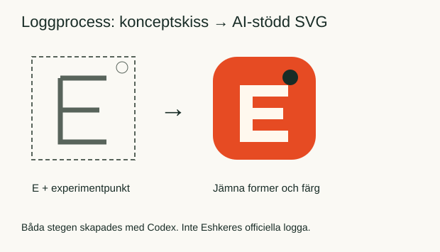

# Planering och reflektion: Eshkere Impact Lab

Datum: 16 november 2026. Uppgift: AWfully Good webbplats.
Inriktning: **Good**, med en fiktiv prototyp som innehåll.
Dokumentet beskriver den genomförda lösningen. AI har hjälpt till med kod, formgivning, logga, skisser och dokumentation. Läs och bearbeta reflektionen med egna erfarenheter inför redovisningen.

## 1. Idé, syfte och målgrupp

Eshkere Impact Lab är en fristående svensk webbplats för att utforska projektidéer inom AI-säkerhet. Besökaren ska förstå syftet, läsa tre exempel och pröva en egen idé med tre enkla frågor. Målet är att göra antaganden tydliga och föreslå ett litet nästa experiment.

Målgruppen är nyfikna elever, studenter och personer som vill börja undersöka ansvarsfull AI utan att redan vara experter. Därför används korta texter, tydliga rubriker, förklarade begrepp och en liten meny. Alla projekt är fiktiva exempel. Inga resultat eller finansieringar påstås vara verkliga.

## 2. Research, inspiration och jämförelse av rörelse

Eshkere är konceptuell inspiration för utforskande och experiment. Referens: https://vaigotakuthescientist.github.io/eshkere/. Sidan kunde inte läsas med webbverktyget under arbetet; dokumentet gör därför inga påståenden om dess faktiska färger eller animationer. Ingen befintlig kod kopierades.

Den egna visuella riktningen är ett redaktionellt labb: varm pappersbakgrund, mörkgrön text, orange accenter, ett rutnät och numrerade steg. Arial/Helvetica med sans-serif som reserv används för text. Georgia/Times New Roman med serif som reserv ger rubrikernas betoning en annan karaktär. Luft och tunna linjer skiljer innehåll utan att varje del behöver en ruta.

Två undersökta tekniska inspirationskällor, lästa 16 november 2026:

- [MDN: transition](https://developer.mozilla.org/en-US/docs/Web/CSS/Reference/Properties/transition). Beskriver övergångar mellan tillstånd. Idén används till knappens bakgrund och en liten förflyttning.
- [MDN: prefers-reduced-motion](https://developer.mozilla.org/en-US/docs/Web/CSS/Reference/At-rules/@media/prefers-reduced-motion). Beskriver hur sidan kan respektera användarens inställning för mindre rörelse. Här stängs animation och övergångar av.

| Alternativ | Startsignal | Fördel | Nackdel / beslut |
| --- | --- | --- | --- |
| Knappövergång, 0,18 sekunder | Muspekaren över knappen | Bekräftar att elementet är klickbart | Ingen information får bero på hover. Tangentbord får tydlig fokusram. Används. |
| Engångsanimation, 0,6 sekunder | Startsidan laddas | Ger labbillustrationen en diskret introduktion | Kan störa vissa användare. Avaktiveras vid minskad rörelse. Används. |
| Oändligt pulserande objekt | Kontinuerligt | Kan dra uppmärksamhet | Distraherar från läsning och bedömning. Väljs bort. |

Detta är en jämförelse av rörelsetekniker och egna designalternativ, inte ett påstående att externa sajters animationer har observerats.

## 3. Webbplatskarta

```text
                 Gemensam meny på alla sidor
          ┌─────────────────────────────────────┐
          │ Översikt ↔ Projektidéer ↔ Utvärdera │
          └─────────────────────────────────────┘
           index.html  projekt.html  utvardera.html

Loggan på varje sida → index.html
Startsidans knappar → Projektidéer / Utvärdera
Varje exempel → Utvärdera med förifyllt idénamn
Sidfot på varje sida → detta planeringsdokument
```

Alla tre sidor länkar direkt till varandra via huvudmenyn. Kontaktsida behövs inte för syftet; uppgiftens startsida/innehåll/kontakt är ett förslag, inte ett tekniskt krav.

## 4. Layoutskisser och logga


Skisserna visar logga, meny, rubriker, text, illustration och knappar. På dator har startsidan två kolumner. Projektidéer visas i rader. Verktyget har formulär till vänster och metod till höger. På mobil blir innehållet en kolumn och menyn är alltid synlig. Detta undviker en extra JavaScript-meny.

Rörelse markeras vid startsidans illustration (sidladdning) och primärknappar (hover). Skisserna är dokumentationsskisser framtagna med AI och återger den valda layouten; de är inte handritade elevoriginal.



Loggidé: ett enkelt E i en kvadrat och en liten punkt som symboliserar ett experiment. Codex skapade både konceptskissen och den slutliga SVG-koden som AI-stöd. Briefen var: ”En enkel E-symbol för ett utforskande labb, läsbar i liten storlek, orange bakgrund, ljus bokstav och mörk experimentpunkt.” Slutformen har rundade hörn, jämna linjer och kan skalas utan att bli suddig. Det är en egen prototyplogga, inte Eshkeres officiella logga. SVG valdes för enkel redigering och liten filstorlek. Ingen separat bildgenerator användes.

## 5. Genomförande och arkitektur

1. Läs uppgiften och bestäm sidornas roller.
2. Lägg projektet i en helt separat mapp.
3. Skapa tre HTML-sidor med samma meny, logga och extern CSS.
4. Skriv innehåll, fiktiva exempel och tydliga begränsningar.
5. Lägg till responsiv layout och diskret rörelse.
6. Lägg till ett litet formulär med JavaScript.
7. Testa länkar, skärmbredder, tangentbord och beräkningar.
8. Dokumentera och packa projektmappen som ZIP.

HTML beskriver innehåll, CSS styr utseende och JavaScript hanterar endast bedömningsverktyget. Inga ramverk, externa typsnitt, installationer eller byggsteg krävs. Menyn upprepas i tre filer för att vara lätt att förstå och fungera utan JavaScript. Nackdelen är att en menyändring måste göras på tre ställen.

Alla sökvägar är relativa. Därför fungerar sidorna direkt från en uppackad mapp och under en framtida undermapp på en webbserver. Beräkningen ligger i funktionen `calculateScore`, separat från koden som uppdaterar sidan. Vid framtida integration kan funktionen flyttas, medan sidans CSS bör avgränsas för att inte påverka Eshkeres övriga design. Projektet använder inget API, ingen databas och ingen lokal lagring.

## 6. Utvärderingsmodell

Besökaren ger tre heltalsbetyg från 1 till 5: möjlig nytta, genomförbarhet och kunskapsläge. Ingen fråga är förvald. Poängen är summan delad med 15, multiplicerad med 100 och avrundad. Alla delar väger lika. Exempel: 3 + 3 + 3 ger 60/100. Lägsta resultat är 20, högsta 100.

Poängen illustrerar personliga antaganden och är inte en validerad metod. Den får inte läsas som procentuell chans att lyckas. Alla delbetyg visas så att ett högt medelvärde inte döljer en svag del. Lågt kunskapsläge prioriteras i förslaget till nästa steg. Därefter prioriteras låg genomförbarhet, sedan låg nytta. Annars föreslås ett avgränsat test.

Tomma obligatoriska fält stoppas av HTML-validering. Namn med enbart mellanslag stoppas av JavaScript. Användartext skrivs med `textContent`. När svar ändras tas föregående resultat bort. Återställning tömmer formuläret. Utan JavaScript finns frågorna och formeln kvar, med en tydlig förklaring och avstängd beräkningsknapp.

## 7. Kravkontroll

| Krav från uppgiften | Lösning / belägg |
| --- | --- |
| Minst tre sammanlänkade HTML-sidor | index.html, projekt.html, utvardera.html; gemensam meny |
| Semantisk HTML | header, nav, main, section, article, aside, footer; en h1 per sida |
| Gemensam extern CSS | css/style.css på alla tre sidor |
| Mobil och dator | Flexbox, Grid och brytpunkter vid 900/680 px; testade bredder i testprotokollet |
| Webbsäkra typsnitt och reserver | Arial/Helvetica/sans-serif och Georgia/Times New Roman/serif |
| Bilder och alt-texter | Lokal SVG-illustration med alt-text; loggbilden har tom alt eftersom länken har eget namn |
| Loggskiss och AI-stödd logga | docs/logo-process.svg och images/logo.svg |
| Sitemap och layoutskisser | Avsnitt 3 samt docs/wireframes.svg |
| Research och jämförelse av rörelse | Avsnitt 2, med källor och designbeslut |
| Frivillig rörelse och JavaScript | Båda ingår enligt projektönskemålet och förklaras här |
| Test och reflektion | docs/testprotokoll.md och avsnitt 8 |
| Projektmapp och planeringsdokument | ZIP med alla filer; detta dokument kan lämnas in separat |

## 8. Reflektion och kodförklaring

**Vilken är målgruppen?** Nyfikna elever, studenter och nybörjare inom AI-säkerhet. Innehållet ska hjälpa dem att ställa tydligare frågor utan att skapa falsk säkerhet genom exakta poäng.

**HTML-exempel:** `<nav aria-label="Huvudmeny">` anger ett navigationsområde och ger det ett begripligt namn. `aria-current="page"` markerar den aktuella sidan. `<label for="idea">` kopplar texten till formulärfältet med `id="idea"`, så att fältet får ett tillgängligt namn.

**CSS-exempel:** `.steps { display: grid; grid-template-columns: repeat(3, 1fr); }` ger tre lika breda kolumner. I mediafrågan för högst 680 px ändras detta till en kolumn. Samma innehåll blir därmed lättare att läsa på en smal skärm.

**JavaScript-exempel:** `Math.round((impact + feasibility + evidence) / 15 * 100)` räknar om tre betyg till modellens poäng. En submit-lyssnare stoppar omladdning med `event.preventDefault()`, läser fälten, anropar beräkningen och skapar resultattext. `textContent` gör att inmatning behandlas som text, även om den innehåller HTML-tecken.

**Vad upptäcktes och rättades?** Den första länkkontrollen hittade att planeringsdokumentet ännu inte hade skapats. Dokumentet lades till innan sluttestet. Testmiljön saknade Playwrights medföljande Chromium; testerna kördes i installerad Microsoft Edge. Slutliga resultat och begränsningar redovisas i testprotokollet utan att kalla automatiserade tester för användartester.

**Vad kan utvecklas vidare?** Genomför användartester med målgruppen. Undersök om frågorna förstås på samma sätt av olika personer. Lägg eventuellt till lokal export av anteckningar, men först när behovet är tydligt. Före integration behövs en granskning av Eshkeres riktiga struktur och formspråk. Poängmodellen bör fortsätta beskrivas som illustrativ om den inte valideras.

## 9. Inlämning

ZIP-filen heter `DittNamn_AwfullyGood.zip` och innehåller en överordnad mapp med samma namn. Ersätt `DittNamn` med ditt inlämningsnamn före Classroom. Arbetsprojektet heter fortfarande `eshkere-impact-lab`. Lämna även in detta planeringsdokument separat enligt uppgiften. Läs koden, gör egna ändringar och komplettera reflektionen med vad du själv kan förklara. Classroom-inlämning ingår inte i prototypen.
